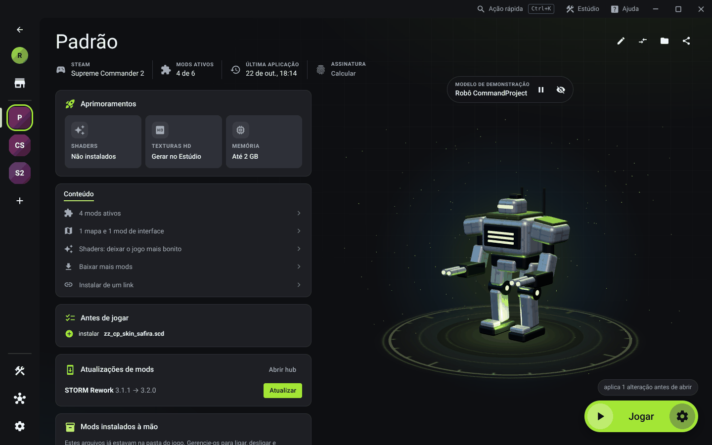
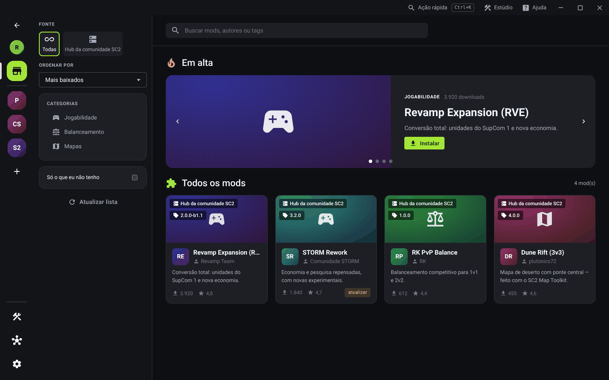
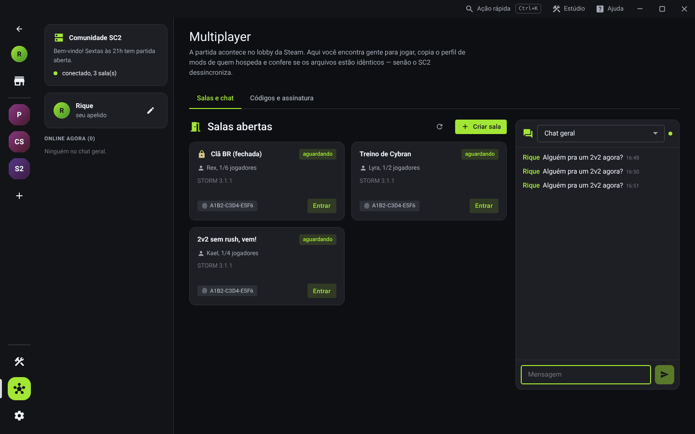
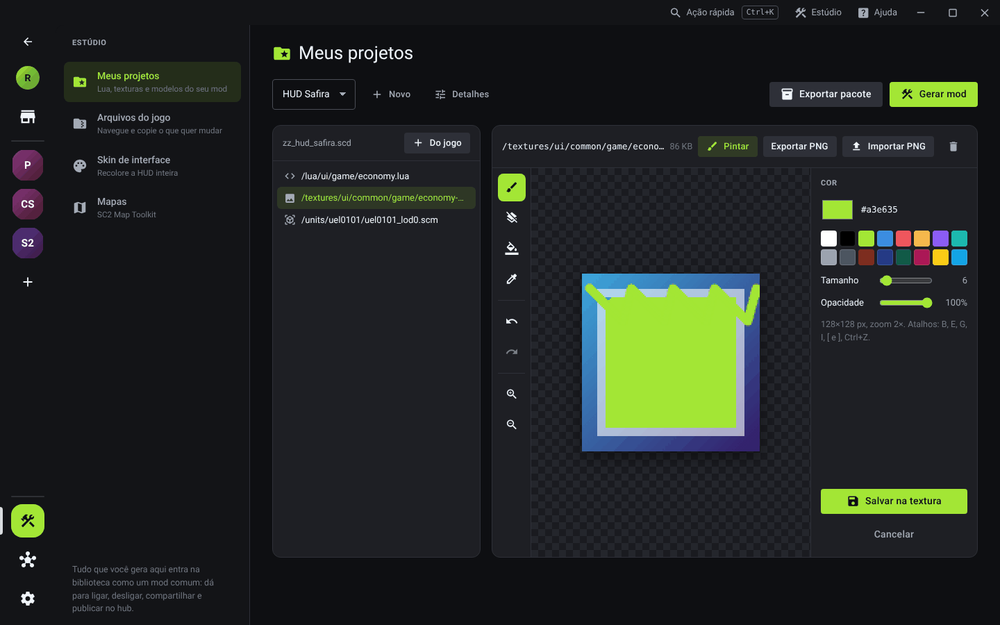
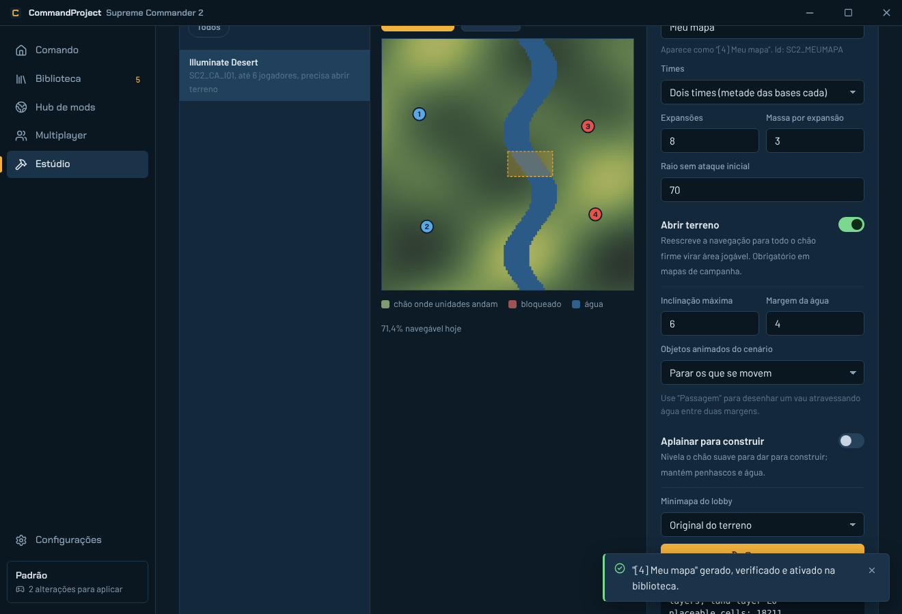
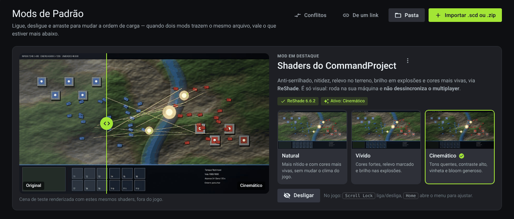
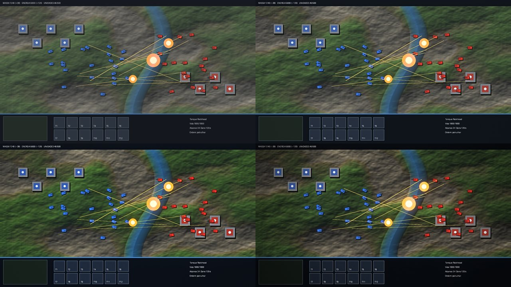
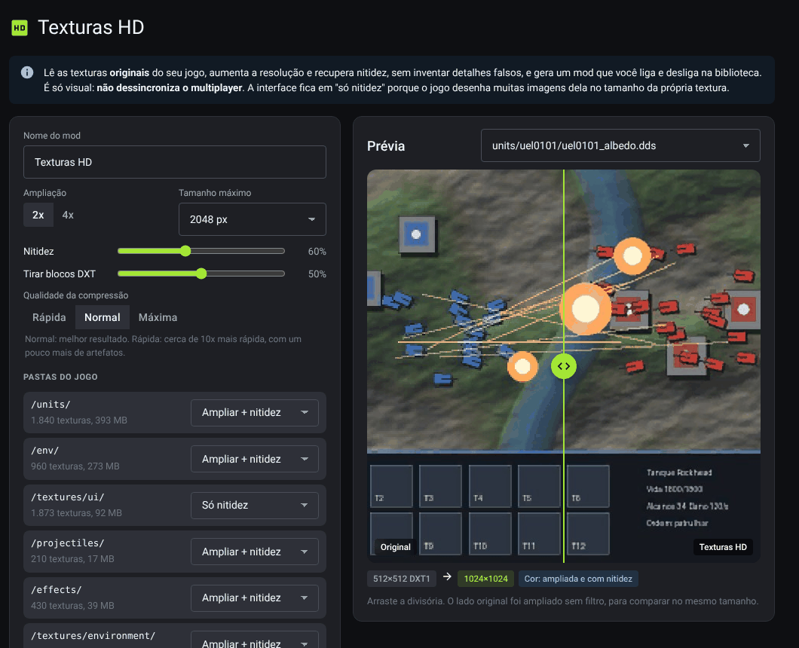
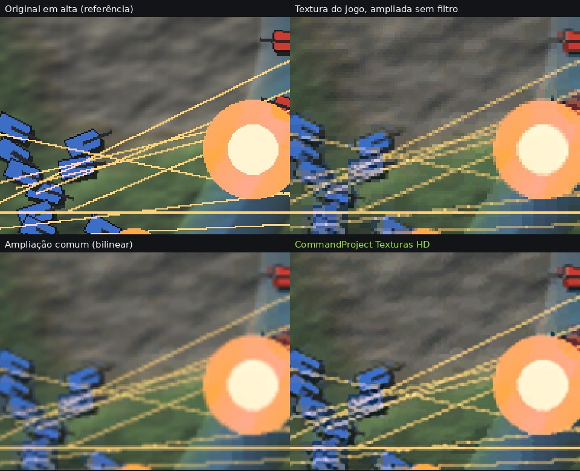

# CommandProject

Launcher, gerenciador e hub de mods para **Supreme Commander 2**. Instale, atualize, organize e
crie mods sem mexer à mão na pasta do jogo, e encontre gente para jogar com os mesmos arquivos.



## O que ele faz

**Tela inicial**
- Uma unidade do seu jogo em 3D, com a textura original, girando sobre uma plataforma luminosa
  (arraste para girar; troque a unidade ou esconda o modelo). O modelo é lido da sua instalação na
  hora de mostrar: o launcher não copia nem distribui arquivos do jogo. Sem o jogo, aparece um robô
  original do CommandProject.
- Card de **Aprimoramentos** (Shaders, Texturas HD, memória) com atalhos para cada um.

**Jogar**
- Encontra o jogo sozinho (bibliotecas da Steam, GOG ou pasta escolhida).
- Botão **Jogar**: aplica o perfil de mods e abre pela Steam (`steam://rungameid/40100`) ou pelo executável.
- Opção de **voltar ao original** automaticamente quando o jogo fecha.

**Gerenciar mods (um "Forge" para o SC2)**
- Importa `.scd`, `.zip` (com vários `.scd` + `mod.json`), pastas soltas (`lua/`, `textures/`… viram um `.scd`)
  ou um **link direto** para um pacote.
- Arraste arquivos para a janela para importar.
- **Perfis** na barra lateral (como instâncias), com liga/desliga e **ordem de carga** por arrastar.
- **Conflitos**: mostra quais arquivos internos cada mod sobrescreve e quem vence.
- Detecta mods instalados à mão e os transforma em mods gerenciados.
- **Ação rápida** (`Ctrl+K`): jogar, aplicar, trocar de perfil ou abrir qualquer tela pelo teclado.

**Hub de mods**
- Loja com destaques, filtros por fonte/categoria e ordenação; instala e atualiza com um clique.
- Fontes: o hub do servidor da comunidade e quantos índices JSON extras você quiser.
- Download verificado por **SHA-256 e tamanho** antes de entrar na biblioteca.

**Multiplayer**
- **Salas e chat** dentro do launcher, via servidor da comunidade (`cp-server`): quem hospeda
  anuncia a sala com o código do perfil; quem entra revisa e instala os mods que faltam.
  Salas fechadas com senha, chat geral e chat por sala.
- O SC2 roda em lockstep: todos precisam dos mesmos arquivos. O launcher calcula a
  **assinatura da pasta** (ex.: `7F3A-91C2-0B5E`) para comparar antes do lobby.
- **Código de perfil** (`CP1-…`): seu amigo cola e fica com exatamente os mesmos mods.
- A partida em si continua no lobby da Steam, que o launcher abre para você.

**Estúdio de criação**
- **Arquivos do jogo**: navega por todos os `.scd` (sempre os originais), com prévia de Lua,
  texturas DDS e modelos 3D `.scm`; exporta para PNG/OBJ/GLB. Lua em bytecode é mostrado pela
  versão em texto de `uncompiled_lua.scd` quando ela existe.
- **Projetos**: copia arquivos do jogo para o seu mod e edita:
  - **Lua** com realce, autocompletar e checagem de blocos;
  - **texturas** com **pintor embutido** (pincel, borracha, balde, conta-gotas, desfazer), ajuste
    de cor e importação de PNG mantendo formato DXT e mipmaps;
  - **modelos** com visualizador 3D e importação de OBJ com **rigging automático** (cada vértice
    segue o osso mais próximo do modelo original) ou preso a um osso escolhido.
  Gera o mod direto na biblioteca e exporta o pacote pronto para o hub.
- **Skin de interface**: recolore a HUD inteira em lote (matiz, saturação, brilho, contraste,
  tingimento), com prévia antes/depois. Gera um mod só com as texturas alteradas.
- **Mapas**: integra o [SC2 Map Toolkit](https://github.com/plutonics72/supcom2-map-toolkit).
  Editor em **3D** (relevo do terreno com a textura do jogo, água e câmera livre) ou 2D. Coloque bases
  e **pontos de extração de massa**, esculpa morros, vales, planaltos, áreas planas e rampas,
  desenhe passagens sobre a água, ligue a borda rochosa e ajuste a economia. Tudo com desfazer
  (Ctrl+Z). O toolkit verifica se todo ponto é navegável e se as bases se alcançam antes de gerar.

**Menu moderno (repaginada nos menus do jogo)**
- Mod do próprio launcher, gerado no seu computador a partir dos arquivos do jogo: menu principal,
  opções, escaramuça, salas e resumo da partida com as cores do launcher (ou outra cor de destaque),
  imagens com mais nitidez e a fonte Roboto no lugar da MagistralTT. Cores de facção e de time ficam
  intactas. Liga e desliga na biblioteca como qualquer mod; não afeta o multiplayer.
- A tela inicial do launcher tem a aba **Mods**, com o que está ligado no perfil e atalho para desligar.

**Shaders (deixa o jogo mais bonito)**
- Mod de pós-processamento próprio para o ReShade (DirectX 9): anti-serrilhado, nitidez adaptativa,
  relevo no terreno, bloom nas explosões e correção de cor. Presets **Natural**, **Vívido** e **Cinemático**.
- O launcher instala o ReShade oficial com um clique (assinatura conferida) e troca o preset; é só
  visual e não dessincroniza o multiplayer. Detalhes em [resources/shaders](resources/shaders/README.md).

**Texturas HD (mais resolução e nitidez)**
- No Estúdio, gera um mod a partir das texturas **originais do seu jogo**: tira os blocos da compressão
  DXT, amplia 2x ou 4x (Lanczos com anti-halo + retroprojeção, que recupera bordas sem inventar
  detalhes) e aplica nitidez adaptativa. Recomprime no mesmo formato, com mipmaps.
- Trata cada tipo de textura do jeito certo: mapas de normal são renormalizados, máscaras não ganham
  nitidez, tabelas de cor/fontes/cubemaps não mudam, e a interface fica em "só nitidez" (o jogo
  desenha muitas imagens dela no tamanho da própria textura).
- Calcula antes quanto de memória de vídeo as texturas vão ocupar e ajusta sozinho para caber.

**Modo 4 GB de memória**
- O SC2 é um programa de 32 bits (2 GB de RAM). O launcher liga a flag *Large Address Aware* no
  executável, que passa a usar até 4 GB num Windows 64 bits. Guarda o original, desfaz com um clique
  e reaplica sozinho se a Steam restaurar o arquivo. (Transformar o jogo em 64 bits de verdade
  exigiria recompilar o motor, cujo código não é público.)

**Atualizações do app**: avisa quando sai uma versão nova nas Releases do GitHub (dá para desligar).

| | |
|---|---|
|  |  |
|  |  |
|  |  |
|  |  |

## Segurança dos arquivos do jogo

O motor de implantação (`crates/cp-core/src/deploy.rs`) foi feito para nunca deixar o jogo quebrado:

1. **Linha de base**: na primeira vez, registra nome, tamanho e SHA-256 de cada `.scd`.
2. **Backup endereçado por conteúdo**: antes de substituir um arquivo (ex.: `lua.scd`), o original
   vai para `backups/<sha256>.scd`.
3. **Diário com intenção**: cada operação grava o que vai fazer antes e o resultado depois.
   Se o PC desligar no meio, o launcher termina ou desfaz a operação na próxima abertura.
4. **Cópia atômica**: escreve num temporário e renomeia; nunca existe arquivo pela metade.
5. **Quarentena**: se um arquivo colocado pelo launcher foi editado por fora, ele é guardado em
   `quarantine/` em vez de apagado.
6. **Voltar ao original** restaura a pasta byte a byte (coberto por testes).

## Servidor da comunidade (`cp-server`)

Um único binário em Rust (axum) que oferece salas, chat e o hub de mods. Não precisa de banco de
dados: as salas vivem na memória e o hub é uma pasta.

```bash
cargo run -p cp-server --release           # http://localhost:8787
docker build -f crates/cp-server/Dockerfile -t cp-server .
docker run -p 8787:8787 -v $PWD/hub:/srv/hub -e CP_SERVER_NAME="SC2 Brasil" cp-server
```

| Variável | Para quê |
|---|---|
| `PORT` | porta HTTP (padrão `8787`) |
| `CP_SERVER_NAME`, `CP_MOTD` | nome e recado exibidos no launcher |
| `CP_HUB_DIR` | pasta do hub (`mods/<id>/<versão>/pacote.zip`), veja [server-example](server-example/README.md) |
| `CP_DATA_DIR` | dados do servidor (padrão `data/`) |
| `CP_TRUST_PROXY` | `1` para ler o IP de `X-Forwarded-For` atrás de um proxy reverso |

Rotas: `GET /api/info`, `GET|POST /api/rooms`, `PATCH|DELETE /api/rooms/{id}` (token do dono),
`POST /api/rooms/{id}/join|leave|heartbeat`, `GET /ws` (chat), `GET /hub/index.json`.
Limites embutidos: 3 salas por IP, 6 conexões de chat por IP, 6 mensagens a cada 10 s,
mensagens de até 500 caracteres; salas sem sinal por 2 minutos somem sozinhas.
Coloque um proxy com HTTPS na frente (Caddy, Nginx): o launcher só aceita `https://`, exceto em `localhost`.

## Arquitetura

```
crates/cp-core     núcleo em Rust (sem interface): jogo, .scd, biblioteca, perfis, implantação,
                   conflitos, hub, multiplayer, DDS, SCM, Lua, estúdio, ponte de mapas
crates/cp-cli      `cp`: o mesmo núcleo pela linha de comando
crates/cp-server   servidor da comunidade: salas, chat (WebSocket) e hub
src-tauri          app desktop (Tauri 2): comandos + eventos de progresso
src                interface (React + TypeScript + Vite)
resources/maptk    SC2 Map Toolkit (MIT, sem alterações) + maptk_bridge.py
resources/shaders  shaders do ReShade (CommandProject.fx) e presets
resources/python   Python embutido (baixado no build do Windows)
docs/HUB_API.md    formato do índice do hub e do mod.json
```

A interface roda também no navegador com um backend simulado (`src/lib/mock.ts`), útil para
trabalhar no visual sem o jogo instalado.

## Desenvolvimento

Requisitos: Rust estável, Node 22, Python 3.9+ (para o Estúdio de Mapas) e, no Windows, o
[WebView2](https://developer.microsoft.com/microsoft-edge/webview2/) (já vem no Windows 10/11).

```bash
npm install
npm run tauri dev        # app completo
npm run dev              # só a interface, no navegador, com dados simulados
npm run test:core        # testes do núcleo e do servidor (cargo test)
npm run test:maps        # testa a ponte do toolkit com um "jogo sintético"
npm run tauri build      # instalador NSIS (Windows)
```

O GitHub Actions (`.github/workflows/build.yml`) roda clippy e os testes, baixa o Python embutido
oficial e gera o instalador do Windows; a cada push na `main` publica o release `v<versão>` com o instalador (mude a versão em `package.json`, `src-tauri/tauri.conf.json` e `src-tauri/Cargo.toml` para lançar outra).

### CLI

```bash
cargo run -p cp-cli -- help
cp status | cp import zz_STORM.scd | cp apply | cp purge | cp conflicts | cp fingerprint
cp link https://exemplo.com/zz_mod.scd     # instala de um link direto
cp hub-build hub/ index.json               # gera o índice de uma pasta de hub
cp hd gerar                                # gera o mod Texturas HD
cp 4gb on                                  # liga o modo 4 GB no executável
```

A CLI usa a mesma pasta de dados do app (`%APPDATA%\io.github.riquebitt.commandproject`), ou `CP_DATA`.

## Limitações conhecidas

- **Ordem de montagem**: o launcher assume que o jogo monta os `.scd` em ordem alfabética e o último
  vence (é o que os mods da comunidade usam com os prefixos `_` e `zz_`). Teste numa partida.
- **Modelos `.scm`**: leitura/escrita do formato da família Supreme Commander (versão 5). O rigging
  automático copia o osso do vértice original mais próximo, sem misturar pesos; malhas muito
  diferentes do original podem deformar nas animações.
- **Lua compilado**: só dá para editar como texto quando o jogo traz a versão em `uncompiled_lua.scd`.
- **HUD**: a edição é por textura e por Lua (layout em código); ainda não há editor visual de arrastar.
- **Partidas**: o jogo em si continua nos lobbies da Steam; o launcher organiza as salas, o chat e os
  mods, mas não substitui o netcode do SC2.

## Créditos

Veja [THIRD_PARTY.md](THIRD_PARTY.md). Supreme Commander 2 é marca registrada de seus respectivos
donos; este projeto não contém nem distribui arquivos do jogo.

Licença: MIT.
