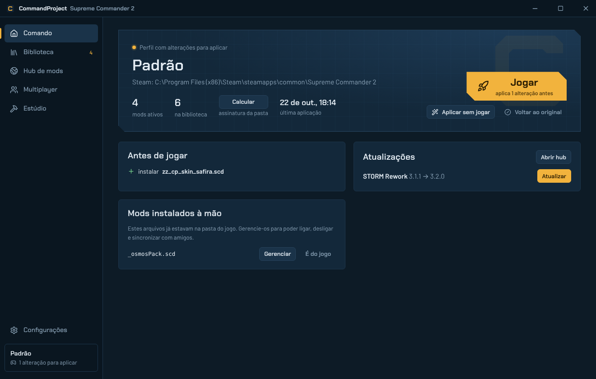

# CommandProject

Launcher e hub de mods para **Supreme Commander 2** — instale, atualize, organize e crie
mods sem mexer à mão na pasta do jogo. Parte do ecossistema **Project Club**.



## O que ele faz

**Jogar**
- Encontra o jogo sozinho (bibliotecas da Steam, GOG ou pasta escolhida).
- Botão **Jogar**: aplica o perfil de mods e abre pela Steam (`steam://rungameid/40100`) ou pelo executável.
- Opção de **voltar ao original** automaticamente quando o jogo fecha.

**Gerenciar mods (como um Forge/Vortex para o SC2)**
- Importa `.scd`, `.zip` (com vários `.scd` + `mod.json`) ou pastas soltas (`lua/`, `textures/`… viram um `.scd`).
- Arraste arquivos para a janela para importar.
- **Perfis** com liga/desliga e **ordem de carga** por arrastar.
- **Conflitos**: mostra quais arquivos internos cada mod sobrescreve e quem vence.
- Detecta mods instalados à mão e os transforma em mods gerenciados.

**Hub de mods**
- Lista mods de um índice JSON (a aba Mods do Project Club), instala e atualiza com um clique.
- Download verificado por **SHA-256 e tamanho** antes de entrar na biblioteca.

**Multiplayer**
- O SC2 roda em lockstep: todos precisam dos mesmos arquivos. O launcher calcula a
  **assinatura da pasta** (ex.: `7F3A-91C2-0B5E`) para comparar antes do lobby.
- **Código de perfil** (`CP1-…`): seu amigo cola e fica com exatamente os mesmos mods,
  baixando o que faltar do hub.

**Estúdio de criação**
- **Arquivos do jogo**: navega por todos os `.scd` (sempre os originais), com prévia de Lua,
  texturas DDS e modelos 3D `.scm`; exporta para PNG/OBJ/GLB.
- **Projetos**: copia arquivos do jogo para o seu mod, edita **Lua** (editor com realce,
  autocompletar e checagem de blocos), **texturas** (ajuste de cor, importar PNG mantendo
  formato DXT e mipmaps), **modelos** (visualizador 3D, importar OBJ — experimental) e gera
  o mod direto na biblioteca. Exporta o pacote pronto para o hub.
- **Skin de interface**: recolore a HUD inteira em lote (matiz, saturação, brilho, contraste,
  tingimento), com prévia antes/depois. Gera um mod só com as texturas alteradas.
- **Mapas**: integra o [SC2 Map Toolkit](https://github.com/plutonics72/supcom2-map-toolkit)
  — escolha um terreno, clique para posicionar as bases, desenhe passagens sobre a água e gere
  o mapa. O toolkit verifica se todo ponto é navegável e se as bases se alcançam antes de gerar.

## Segurança dos arquivos do jogo

O motor de implantação (`crates/cp-core/src/deploy.rs`) foi feito para nunca deixar o jogo quebrado:

1. **Linha de base** — na primeira vez, registra nome, tamanho e SHA-256 de cada `.scd`.
2. **Backup endereçado por conteúdo** — antes de substituir um arquivo (ex.: `lua.scd`), o original
   vai para `backups/<sha256>.scd`.
3. **Diário com intenção** — cada operação grava o que vai fazer antes e o resultado depois.
   Se o PC desligar no meio, o launcher termina ou desfaz a operação na próxima abertura.
4. **Cópia atômica** — escreve num temporário e renomeia; nunca existe arquivo pela metade.
5. **Quarentena** — se um arquivo colocado pelo launcher foi editado por fora, ele é guardado em
   `quarantine/` em vez de apagado.
6. **Voltar ao original** restaura a pasta byte a byte (coberto por testes).

## Arquitetura

```
crates/cp-core     núcleo em Rust (sem interface): jogo, .scd, biblioteca, perfis, implantação,
                   conflitos, hub, multiplayer, DDS, SCM, Lua, estúdio, ponte de mapas
crates/cp-cli      `cp`: o mesmo núcleo pela linha de comando
src-tauri          app desktop (Tauri 2): comandos + eventos de progresso
src                interface (React + TypeScript + Vite)
resources/maptk    SC2 Map Toolkit (MIT, sem alterações) + maptk_bridge.py
resources/python   Python embutido (baixado no build do Windows)
docs/HUB_API.md    formato do índice do hub e do mod.json
```

A interface roda também no navegador com um backend simulado (`src/lib/mock.ts`), útil para
trabalhar no visual sem o jogo instalado.

## Desenvolvimento

Requisitos: Rust estável, Node 22, Python 3.9+ (para o Estúdio de Mapas) e, no Windows, o
[WebView2](https://developer.microsoft.com/microsoft-edge/webview2/) (já vem no Windows 10/11).

```bash
npm install
npm run tauri dev        # app completo
npm run dev              # só a interface, no navegador, com dados simulados
npm run test:core        # testes do núcleo (cargo test)
npm run test:maps        # testa a ponte do toolkit com um "jogo sintético"
npm run tauri build      # instalador NSIS (Windows)
```

O GitHub Actions (`.github/workflows/build.yml`) roda os testes, baixa o Python embutido oficial
e gera o instalador do Windows; em tags `v*` cria um rascunho de release.

### CLI

```bash
cargo run -p cp-cli -- help
cp status | cp import zz_STORM.scd | cp apply | cp purge | cp conflicts | cp fingerprint
```

A CLI usa a mesma pasta de dados do app (`%APPDATA%\club.project.commandproject`), ou `CP_DATA`.

## Limitações conhecidas

- **Ordem de montagem**: o launcher assume que o jogo monta os `.scd` em ordem alfabética e o último
  vence (é o que os mods da comunidade usam com os prefixos `_` e `zz_`). Teste numa partida.
- **Modelos `.scm`**: leitura/escrita do formato da família Supreme Commander (versão 5). A importação
  de OBJ prende toda a malha a um osso (sem pesos), por isso está marcada como experimental.
- **Lua compilado**: arquivos em bytecode não são editáveis como texto; use `uncompiled_lua.scd`.
- **HUD**: a edição é por textura e por Lua (layout em código); ainda não há editor visual de arrastar.
- **Online**: as partidas continuam nos lobbies da Steam. Lista de salas e chat dentro do launcher
  dependem da integração com o Project Club (próxima etapa).

## Créditos

Veja [THIRD_PARTY.md](THIRD_PARTY.md). Supreme Commander 2 é marca registrada de seus respectivos
donos; este projeto não contém nem distribui arquivos do jogo.

Licença: MIT.
